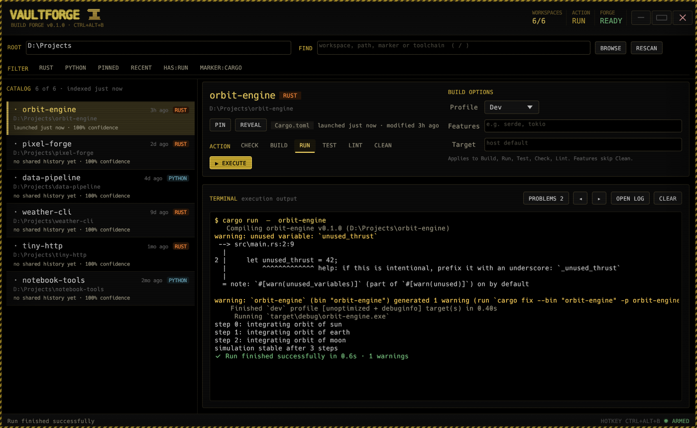

# VaultForge

**A fast, offline build launcher for your Rust and Python projects on Windows.**

VaultForge finds every Rust and Python project under a folder you choose and lets you
check, build, run, test, lint or clean any of them with one click, or with Enter. You get
a live progress bar that learns how long each build takes, a colour-coded terminal that
keeps errors in view, and a global hotkey, **Ctrl+Alt+B**, to bring it up from anywhere.
Nothing leaves your machine: no account, no cloud, no telemetry.



> Status: early public release (0.x). It is used daily by its author, but expect rough
> edges. See [Known limitations](#known-limitations).

---

## What it does

- **Finds your projects.** It scans a folder for `Cargo.toml`, `pyproject.toml`,
  `requirements.txt`, `setup.py`, `setup.cfg` and `Pipfile`, skipping `target`,
  `node_modules`, virtual environments and other build output. The list is ranked by
  what you pinned, built or changed most recently, and it's cached, so it appears
  instantly the next time.
- **Runs the right command.**
  - Rust: **Check**, **Build**, **Run**, **Test**, **Lint** (Clippy) and **Clean**, with a
    Dev/Release switch, features and a target triple.
  - Python: **Check** (compiles every file) and **Run**. It picks the project's own `.venv`,
    `venv` or `env` when there is one, and you can choose the entry file or run a module
    (`python -m`).
- **Shows real progress.** The bar learns how long each project takes to build, so it
  moves smoothly instead of jumping to 99% and sitting there. It also shows the crate
  count, the elapsed time, and the error and warning totals as they happen.
- **Keeps errors in view.**
  - A build that has already failed says so immediately, with a **STOP** button, instead
    of compiling for another five minutes.
  - **PROBLEMS** shows only the warning and error lines, with jump buttons to step between them.
  - The first errors are pinned above the summary, even when a noisy build prints
    thousands of warnings.
  - The complete output of every run is saved to a log file (**OPEN LOG**).
- **Catches locked builds before they start.** On Windows a running program can't be
  replaced, so rebuilding while your app is open fails at the very end. VaultForge
  notices first and offers to stop it (**STOP & BUILD**), build anyway, or cancel.
- **Tracks warning debt.** Each project shows its warning count from the last build and
  how it changed, e.g. `992 warnings (+37)`.
- **Opens from anywhere.** **Ctrl+Alt+B** brings VaultForge up, or puts it away if it's
  already in front. You can turn this off; see [The Ctrl+Alt+B hotkey](#the-ctrlaltb-hotkey).

### Keyboard

| Key | Does |
|---|---|
| `/` | Jump to the search box |
| `↑` `↓` | Move through the project list |
| `Enter` | Run the selected project's default action |
| `Ctrl+R` | Rescan the folder |
| `Ctrl+P` | Pin or unpin the selected project |
| `Ctrl+Alt+B` | Show or hide VaultForge (anywhere in Windows) |

The search box also understands `pinned`, `recent`, `has:run`, `marker:cargo`,
`toolchain:rust` and `toolchain:python`.

## Download

Get the latest version from the [Releases page](https://github.com/JunkfoodJon/VaultForge/releases):

- **`VaultForge-<version>-setup.exe`**: the installer (recommended). It installs for your
  Windows account only, needs no Administrator rights, adds a Start Menu shortcut
  (and a desktop one if you tick the box), and adds an uninstaller in Settings → Apps.
- **`VaultForge-<version>-portable.zip`**: no install. Unzip it anywhere and run
  `VaultForge.exe`. If you put the folder inside your projects folder, VaultForge scans that
  folder by default.
- **`SHA256SUMS.txt`**: checksums to verify a download (see [SECURITY.md](SECURITY.md)).

**Windows will warn you.** The files aren't code-signed yet, so SmartScreen says
"unknown publisher". Click *More info*, then *Run anyway*, or
[build it yourself](#build-from-source).

## Requirements

- **Windows 10 or 11, 64-bit.** VaultForge doesn't need Administrator rights, and it
  doesn't need the Visual C++ Redistributable.
- **The toolchains for the projects you want to build:**
  - [Rust](https://rustup.rs) for Rust projects (`cargo` is found even when Rust was
    installed after you signed in);
  - [Python 3](https://www.python.org/downloads/) with the `py` launcher, for Python
    projects without their own virtual environment.

  VaultForge tells you which one is missing if a command can't start.
- **Graphics:** any GPU driver with OpenGL or Direct3D 12. VaultForge tries OpenGL first
  and falls back to Direct3D automatically, so it also runs in most virtual machines
  and remote-desktop sessions.

## First run

1. VaultForge picks a folder to scan: the folder it was unzipped into (if that holds
   projects), or the first of `source\repos`, `Documents\GitHub`, `GitHub`, `Projects`,
   `dev`, `code` or `src` in your user folder.
2. If that isn't where your projects live, press **BROWSE** (or type a path and press
   Enter). VaultForge remembers your choice.
3. Pick a project, pick an action, and press **EXECUTE** (or just press Enter).

## The Ctrl+Alt+B hotkey

To make Ctrl+Alt+B work while VaultForge is closed, a tiny listener keeps running in the
background. It's the same `VaultForge.exe`, started with `--broker`. It uses about 2 MB of
memory, no CPU while idle, and has no window. It starts when you sign in, through a
`VaultForge Hotkey Broker` entry under
`HKCU\Software\Microsoft\Windows\CurrentVersion\Run`. If you see a second
`VaultForge.exe` in Task Manager after closing the window, that's the listener.

**To turn it off**, click **HOTKEY** in the bottom-right corner of the window and untick
*Ctrl+Alt+B opens VaultForge*. That stops the listener and removes the sign-in entry.
Tick the box again to bring it back.

If another program already uses Ctrl+Alt+B, the indicator shows **KEY BUSY**, and the
listener takes over the key as soon as that program lets go of it.

## Where it keeps its files

Everything lives in `%APPDATA%\VaultTools`:

| File | What it holds |
|---|---|
| `shared-history.json` | Pins, last build/run times and learned build durations. Shared with VaultLauncher. |
| `vaultforge-settings.json` | The folder you scan and whether the hotkey is on |
| `vaultforge-catalog.json` | The last scan, so the list shows instantly |
| `vaultforge-broker-status.json`, `vaultforge-gui.pid`, `vaultforge-shortcuts.stamp` | Housekeeping for the hotkey listener |
| `logs\` | The full output of each run, and `vaultforge-crash.log` if VaultForge ever crashes |

The portable version also adds a `VaultForge Portable` Start Menu shortcut the first time
it runs. See [PRIVACY.md](PRIVACY.md) for the complete picture.

**Uninstalling:** use Settings → Apps. The uninstaller stops the listener and removes
its sign-in entry and the shortcuts. It asks before deleting your settings, cache and logs,
and it always keeps `shared-history.json`, because VaultLauncher uses it too. For the
portable version, turn the hotkey off (see above), then delete the folder.

## Build from source

1. Install [Rust](https://rustup.rs) (stable, MSVC toolchain, 1.85 or newer) and the
   *Visual Studio Build Tools* with the "Desktop development with C++" workload.
2. Build and run:

   ```powershell
   cargo build --release
   .\target\release\VaultForge.exe
   ```

Run the tests with `cargo test`.

To build the installer and portable zip yourself, install [NSIS 3](https://nsis.sourceforge.io)
and run:

```powershell
powershell -ExecutionPolicy Bypass -File installer\package.ps1
```

It writes `setup.exe`, the zip and `SHA256SUMS.txt` to `installer\out\`.

## Known limitations

- **Windows only.**
- **Rust and Python only.** A folder that is both a Rust and a Python project (for
  example a PyO3 crate with a `pyproject.toml`) is listed but has no actions yet.
- **Not code-signed yet**, so SmartScreen warns about an unknown publisher, and some
  antivirus tools may be wary of a program that starts other programs and registers a
  hotkey. The source is all here.
- **Building runs the project's code.** `cargo build` runs build scripts and macros, and
  Run and Test run the program itself. Only build projects you trust, as with any IDE.

## Troubleshooting

- **The window doesn't open, or draws garbage.** Set the environment variable
  `VAULTFORGE_RENDERER=wgpu` to use Direct3D first, then start VaultForge again. If it
  still fails, VaultForge shows the error. Please include it in an issue.
- **"couldn't start cargo" / "couldn't start Python".** Install the toolchain (see
  [Requirements](#requirements)), then start VaultForge again.
- **VaultForge closed unexpectedly.** Look for `%APPDATA%\VaultTools\logs\vaultforge-crash.log`
  and attach it to an [issue](https://github.com/JunkfoodJon/VaultForge/issues/new/choose).

## Project layout

```
src/main.rs        startup, window placement, renderer fallback, crash reporting
src/app.rs         the interface: catalog, actions, terminal
src/theme.rs       the shared Vault look (CRT amber), also used by VaultLauncher
src/discovery.rs   the project scanner and ranking
src/execution.rs   command plans, process spawning, progress and diagnostics parsing
src/broker.rs      the Ctrl+Alt+B listener, single-instance handling (raw Win32 FFI)
src/history.rs     settings and the shared history file
installer/         NSIS installer script + package.ps1 (release builds)
```

## Security issues

Please report vulnerabilities privately. See [SECURITY.md](SECURITY.md).

## License

VaultForge's own code is licensed for noncommercial use under the
[PolyForm Noncommercial License 1.0.0](LICENSE.md). Third-party components are credited
in [THIRD_PARTY_NOTICES.md](THIRD_PARTY_NOTICES.md).
